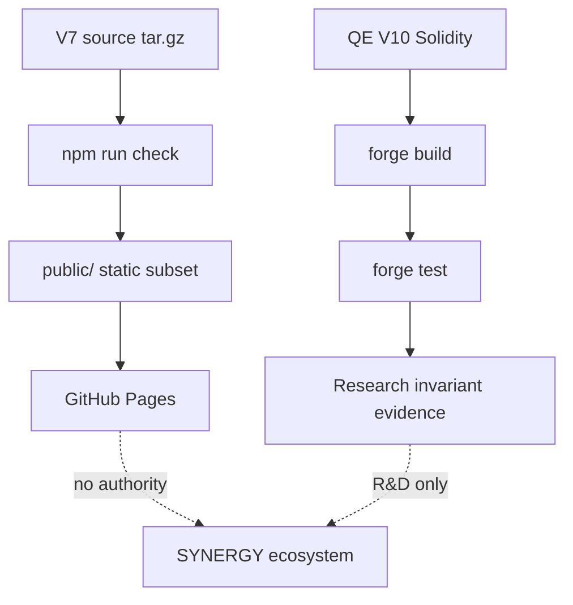

# ⛓️ SINERGYCHAIN / synergy_chain — verified source, EVM & deployment dossier

> **Version in repository:** `7.0.0`.
> **Статус:** 🟡 CANDIDATE/R&D — packaged Node/web source, CI/Pages pipeline and QE V10 Solidity testbed exist.
> **Проверено по фактическому `main`:** 29.09.2026.

## 1. 🎯 Задача

`synergy_chain` combines a packaged SINERGYCHAIN Growth OS application source with an EVM monetary experiment (`qe_v10`).

These are different evidence surfaces:

1. packaged web/Node application bundle;
2. static GitHub Pages safe-public subset;
3. Solidity QE V10 research contracts/tests.

They must not be collapsed into one “production blockchain” claim.

## 2. 📦 Factual repository map

```text
synergy_chain/
├── VERSION                  # 7.0.0
├── SECURITY.md
├── docs/
│   ├── DEPLOYMENT.md
│   └── LEGACY_DISTILLATION_V2_OWNER.md
├── source/
│   ├── ABOUT.md
│   ├── README.md
│   └── SINERGYCHAIN_GROWTH_OS_V7_SOURCE.tar.gz
├── unpack-source.sh
├── qe_v10/
│   ├── foundry.toml
│   ├── src/QEV10TwoElevator.sol
│   └── test/QEV10TwoElevator.t.sol
└── .github/workflows/
    ├── ci.yml
    └── pages.yml
```

## 3. 📦 Packaged source bundle

Main application source is stored as:

`source/SINERGYCHAIN_GROWTH_OS_V7_SOURCE.tar.gz`

CI extracts it into `_source` and runs:

```bash
npm run check
```

This means the canonical visible repo stores a source archive rather than a fully expanded Node project tree.

That is reproducible only if the archive itself remains immutable/versioned and its internal package lock/dependencies are valid.

## 4. ⚙️ CI workflow

`.github/workflows/ci.yml` contains two jobs.

### Source validation

- checkout;
- extract V7 tar.gz;
- Node 20;
- `npm run check`.

### QE V10 EVM

- checkout;
- Foundry stable;
- `forge build`;
- `forge test -vvv`.

These are concrete automated validation definitions. README does not claim latest GitHub-hosted runner success without inspecting observed runs.

## 5. 🌐 GitHub Pages boundary

`pages.yml`:

1. extracts source archive;
2. verifies `_source/public/index.html` and `package.json`;
3. runs `npm run check`;
4. uploads **only `_source/public`**;
5. deploys Pages artifact.

This is a strong authority boundary: public static Pages does not deploy server-side application source.

`docs/DEPLOYMENT.md` explicitly says Pages cannot run:

- Node.js sessions;
- encrypted API Vault;
- live model calls;
- CRM writes;
- CFO database operations;
- real social-network publishing.

Production backend requires separate VPS/container/app platform.

## 6. 🧪 QE V10 research contracts

`qe_v10/src/QEV10TwoElevator.sol` defines a self-contained test system:

- `T10Token`;
- `T10BridgeVault`;
- `T10DebtBook`;
- `T10FixedDex`;
- `T10TwoElevatorPump`.

The test tokens are minimal research primitives, **not production ERC-20 implementations**.

## 7. 🏦 QE V10 model

Two bridge vaults hold ETH-like and USDC-like test tokens.

`T10FixedDex` converts at fixed price with fee.

Pump has positive/negative legs:

- swap principal;
- lock one side;
- calculate modeled gross profit;
- split realized/deferred;
- release opposite bridge liquidity;
- repay stand-in principal to fixed sink addresses;
- reinvest part of realized amount;
- represent deferred amount as debt;
- optional QT burn of debt.

`cumulativeQEPnl` tracks modeled realized component.

## 8. 🧮 Canonical bridge NAV

Test helper and contract use:

[
NAV_{bridge}=
ETH_{vault}	imes Price + USDC_{vault}
]

This is much stronger than counting internal emissions as profit because tests explicitly assert conservation/loss behavior.

## 9. 🧪 QE V10 tests

Inspected Foundry tests include:

### Zero-fee asymmetric supercycle conserves NAV

After positive + negative legs:

```text
end NAV ~= start NAV
debtUsd == 0
```

Tolerance is tiny integer rounding.

### Both elevators cannot rise at zero fee

Test requires that both bridge reserve balances cannot simultaneously exceed starts after full QT.

### Fee makes pump lose canonical NAV

With 30 bps fixed DEX fee:

```text
end NAV < start NAV
```

This is important negative evidence against “free value creation”.

### Debt QT does not move canonical balances magically

Deferred debt can be issued/burned, while bridge reserve direction remains separately checked.

## 10. 🛡️ Economic invariants

```text
QE debt issue != external profit
debt burn      != bridge asset creation
internal cumulativeQEPnl != independent proof of owned external wealth
zero-fee closed loop should not create canonical NAV
fees should reduce canonical NAV absent external edge
both reserve elevators cannot rise from internal mechanics alone
```

## 11. 🔐 Smart-contract security limitations

QE V10 contracts are intentionally test-oriented and omit many production requirements:

- T10Token `mint` is unrestricted;
- no audited ERC-20 library;
- owner/controller setup is minimal;
- fixed-price DEX;
- sink addresses are hard-coded stand-ins;
- no oracle;
- no reentrancy/security framework;
- no upgrade governance;
- no real flash-loan protocol;
- no bridge proof verification.

Therefore passing Foundry properties would validate model invariants, not production security.

## 12. 📚 Legacy distillation

`docs/LEGACY_DISTILLATION_V2_OWNER.md` assigns:

- 2 mechanisms;
- 6 extracted legacy code units;
- IDs MECH-0211, MECH-0212;
- domain: visualization/presentation support.

Promotion boundary: dashboard/simulated metric/UI status never becomes accounting, settlement or governance truth.

## 13. 🏗️ Architecture



## 14. 🛠️ Reproducibility

Web/source:

```bash
./unpack-source.sh
cd _source
npm run check
```

QE V10:

```bash
cd qe_v10
forge build
forge test -vvv
```

These are expected paths from repository definitions; observed CI status must be recorded separately.

## 15. ⚠️ Failure modes

| Failure | Consequence |
|---|---|
| source archive changes without provenance | reproducibility drift |
| Pages exposes server-side secrets | public leak |
| static UI treated as backend | authority confusion |
| unrestricted test mint mistaken for production token | severe security error |
| fixed DEX model generalized to market | invalid economic conclusion |
| cumulativeQEPnl used instead of bridge NAV | false value claim |

## 16. 📊 Evidence maturity

| Layer | Status |
|---|---|
| versioned source archive | ✅ |
| Node check workflow | ✅ definition |
| safe static Pages subset | ✅ architecture |
| QE V10 contracts | ✅ R&D source |
| QE Foundry tests | ✅ source |
| conservation/loss assertions | ✅ in tests |
| production chain security | ❌ |
| real bridge proofs | ❌ |
| external economic profit | ❌ |
| observed production deployment | ❌ |

## 17. 🚀 Roadmap

1. hash/provenance manifest for source archive;
2. SBOM/package lock validation;
3. observed CI evidence;
4. replace test token with hardened libraries for any production branch;
5. property/fuzz tests;
6. real oracle/bridge proof model only in separate production design;
7. distinguish public portal release from backend release;
8. connect evidence to federation maturity gates.

## 18. 🛑 Что project НЕ утверждает

- that QE V10 prints external wealth;
- that test tokens are production-safe;
- that GitHub Pages is full backend;
- that packaged source is currently deployed;
- that test cumulative PnL equals HardNAV;
- that internal debt burn creates assets.

---

[🧭 SYNERGY SYSTEM](https://github.com/Shtenco/synergy_system) · [📚 Atlas](https://github.com/Shtenco/synergy_system/blob/main/docs/SYNERGY_REPOSITORY_ATLAS.md)
