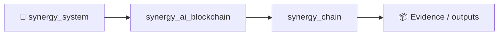

# SINERGYCHAIN · Growth OS V7

Private source repository for the SINERGY ecosystem portal and business operating system.

## What is inside

- SINERGYCHAIN / OGAS 2.0 public portal
- OLGA AGI full-screen multi-agent chat
- Single-model, chain, consensus, debate and AI-department modes
- Recursive compressed conversation memory
- Dynamic rotation of free OpenRouter models
- Business Expert Autopilot
- AI SMM, AI CRM, AI Sales and AI CFO
- Encrypted server-side API Vault
- Static GitHub Pages build
- Node.js production backend

## Repository structure

The complete reproducible source tree is stored in:

`source/SINERGYCHAIN_GROWTH_OS_V7_SOURCE.tar.gz`

GitHub Actions extracts the bundle, runs validation and deploys only the static `public/` directory to GitHub Pages. Backend code, runtime data and API secrets are never published by Pages.

## Local launch

```bash
mkdir synergychain-v7
cd synergychain-v7
tar -xzf ../source/SINERGYCHAIN_GROWTH_OS_V7_SOURCE.tar.gz
npm run check
npm start
```

Open `http://localhost:3000`.

## Static demo

After unpacking, open `public/index.html`, or run:

```bash
node scripts/static-server.js
```

## Security

Never commit real API keys. Configure integrations through the encrypted API Vault or environment variables on the deployment server. See `SECURITY.md`.

## GitHub Pages

The workflow `.github/workflows/pages.yml` publishes the static portal from the private repository. The Pages website itself is publicly accessible unless GitHub Enterprise private Pages is configured.

© SINERGY / SHTENCO. Proprietary project.


<!-- SYNERGY-FEDERATION-PASSPORT:START -->
---

## 🧭 SYNERGY federation passport

**Домен:** ⛓️ SINERGYCHAIN R&D  
**Архитектурный родитель:** [`synergy_ai_blockchain`](https://github.com/Shtenco/synergy_ai_blockchain)  
**Архитектурный корень:** [`synergy_system`](https://github.com/Shtenco/synergy_system)



Эта диаграмма фиксирует место в документационной федерации. Реальная code/runtime dependency должна подтверждаться отдельными артефактами.

### Навигация

- [📚 Атлас всех 75 репозиториев](https://github.com/Shtenco/synergy_system/blob/main/docs/SYNERGY_REPOSITORY_ATLAS.md)
- [🧾 Машиночитаемый registry](https://github.com/Shtenco/synergy_system/blob/main/registry/SYNERGY_REPOSITORIES.json)
- [🧭 SYNERGY SYSTEM](https://github.com/Shtenco/synergy_system)

### Evidence rule

`GREEN` присваивается только воспроизводимым утверждениям. Исследовательский код, диаграмма или заявленная метрика без проверяемого artifact trail остаются `R&D/CANDIDATE`.

<!-- SYNERGY-FEDERATION-PASSPORT:END -->